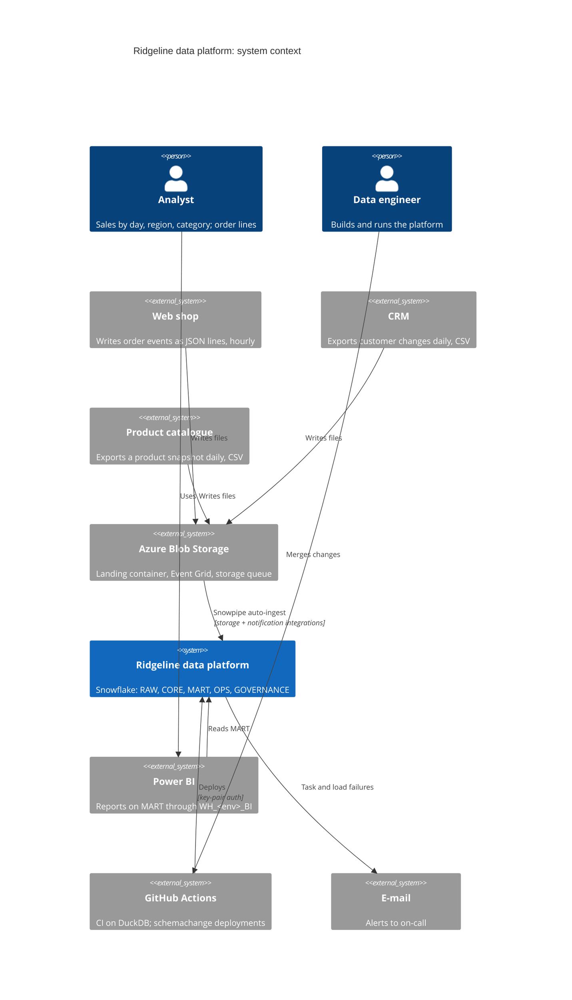
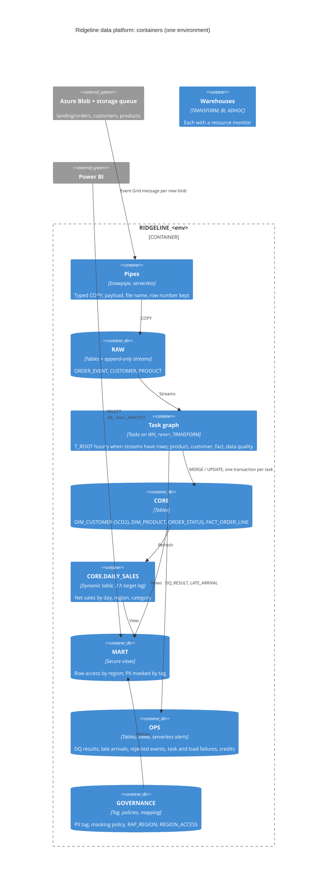

# Architecture (C4)

Ridgeline Outdoor Supply is fictional. Every file the pipeline reads is
written by `generator/ridgeline.py`.

## Level 1: system context

## Level 2: containers

Inside one environment's account objects and database (`RIDGELINE_<env>`).

## Deployment

| What | Where it is defined | How it is deployed |
| --- | --- | --- |
| Roles, warehouses, resource monitors, the database, integrations | `migrations/admin` (sizes and quotas: `R__warehouse_sizes_and_quotas.sql`) | `admin.yml`, by hand, per environment (ADR-0006) |
| Schemas, access roles, tables, pipes, streams, policies | `migrations/database/V*` | `deploy.yml` on merge: dev, then prd after approval |
| Tasks, dynamic table, MART views, OPS views and alerts | `migrations/database/R__*` plus `transform/` | same, whenever the rendered text changes |

## Data flow for one order line

1. The shop writes `orders/2026/01/05/events_14.json`. One ORDER_CREATED
   record per line, with the order header repeated.
2. Event Grid queues a message. `RAW.PIPE_ORDER_EVENT` loads the file into
   `RAW.ORDER_EVENT`, with typed columns plus `payload`, `file_name` and
   `file_row_number`.
3. At :15 past the hour, `T_ROOT` sees rows in `RAW.ORDER_EVENT_STREAM`.
   After the two dimension tasks, `T_FACT_ORDER_LINE`:
   - sets the order's status from the newest event;
   - inserts the line once, keyed to the customer version valid at the
     order time (or -1), or, if a required field is missing, writes the
     event to `OPS.REJECTED_EVENT` instead;
   - re-keys lines whose customer arrived late.
4. `T_DATA_QUALITY` runs eight checks into `OPS.DQ_RESULT` and fails if an
   error-severity check finds rows.
5. Within two hours, `CORE.DAILY_SALES` includes the line. Power BI reads
   it through `MART.DAILY_SALES`, filtered to the regions the user's roles
   map to.
